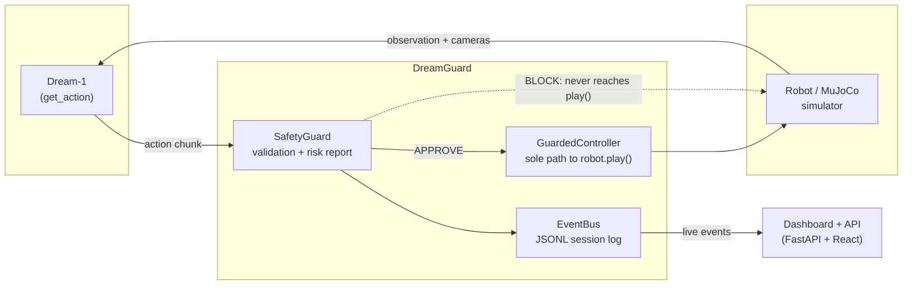
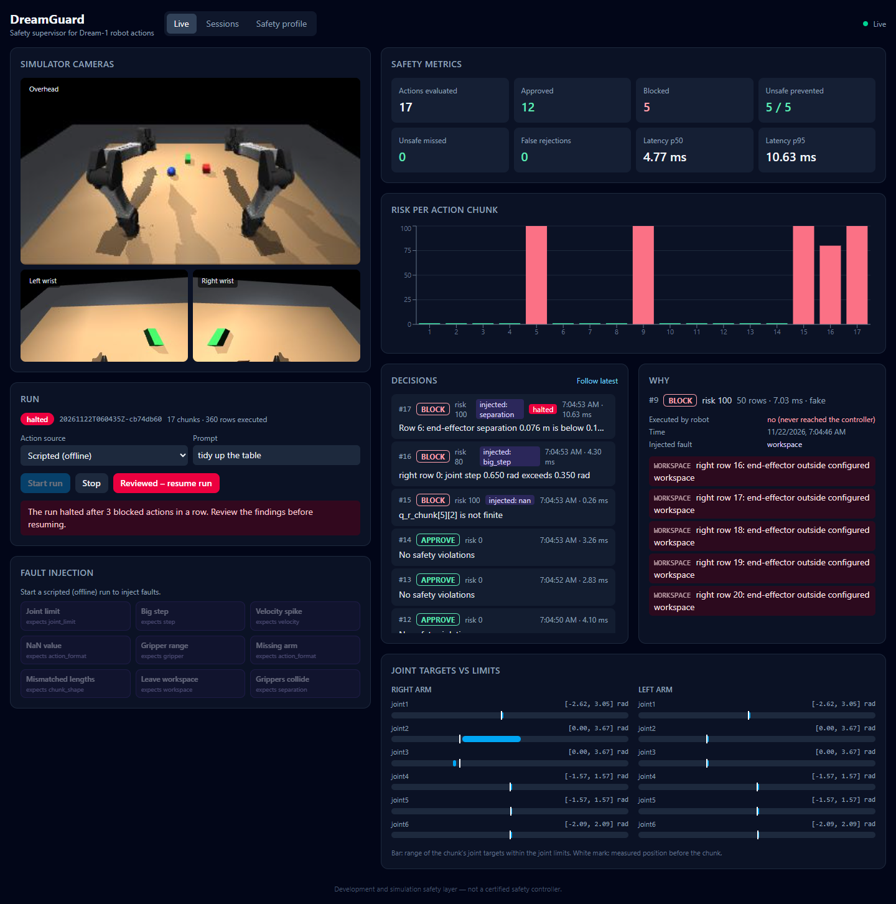

# DreamGuard

A fail-closed safety middleware for Dream-1 action chunks. Dream-1 decides what a
bimanual YAM robot should do; DreamGuard independently checks every action chunk
before it reaches the simulator or controller, blocks unsafe or unverifiable
actions, and explains every decision.



A blocked action is never executed: the robot holds its last approved pose, the
decision is logged with its findings, and the run halts after repeated blocks.
See [documentation/ARCHITECTURE.md](documentation/ARCHITECTURE.md) for the full
component breakdown.



## Verified against real Dream-1 output

DreamGuard was run against the live Dream-1 policy driving the local YAM
simulator: **61 paid inference calls**, from the attempt script and from live runs
started in the dashboard. In one 20-call run DreamGuard approved 11 chunks and
blocked 9; every block was a real joint-limit violation caught before execution.
There were zero false rejections under the tuned profile. All replies are
recorded under `fixtures/dream1/` and replay offline for free.

## What DreamGuard checks

For each `q_r_chunk` and `q_l_chunk` action returned by Dream-1:

- required action chunks exist;
- each chunk is a non-empty sequence of rows;
- each row contains six joint targets plus one gripper target;
- both arm chunks have the same number of rows, within the configured `min_rows` / `max_rows`;
- the measured joint state is present and valid, and the first row is step-checked against it;
- all values are finite numbers;
- configured joint position limits are respected;
- configured per-row joint step limits are respected;
- optional per-joint velocity limits (rad/s at the configured `action_hz`) are respected;
- gripper targets remain in the configured range (default `[0, 1]`); with `gripper_tolerance`, tiny overshoots (e.g. a closed gripper smoothed to -0.01) are a warning and are clamped;
- targets close to a joint limit raise a non-blocking near-limit warning;
- optional forward-kinematics workspace and end-effector separation checks are applied when you provide robot-specific kinematics.

## Repository layout

```text
src/dreamguard/    core safety library (guard, checks, reports, controller, events, metrics)
  sim/             local MuJoCo bimanual YAM simulator + forward kinematics
  sources/         Dream-1 clients: live SDK, scripted fake, session replay
  profiles/        JSON safety profiles (yam_sim carries real YAM joint ranges)
backend/           FastAPI service: runs, sessions, safety, metrics, streams (see backend/README.md)
frontend/          React + Vite + TypeScript dashboard (see frontend/README.md)
integrations/      Dream-1 control-loop integration skeleton
scripts/           SDK check and paid-attempt runner
fixtures/dream1/   recorded real Dream-1 replies (replay for free)
documentation/     PRD, implementation plan, architecture, demo guide
tests/             core test suite
```

## Windows setup (PowerShell)

Install Python 3.12, Node.js 22 and Git. Then:

```powershell
git clone https://github.com/Rouxxel/dreamguard.git
cd dreamguard

py -3.12 -m venv .venv
.\.venv\Scripts\Activate.ps1

python -m pip install --upgrade pip
python -m pip install -e ".[dev,sim]" -r backend/requirements.txt

cd frontend
npm install
cd ..
```

The simulator, backend, dashboard, demos and the whole test suite run without an
API key. The key is only needed for live Dream-1 calls:

```powershell
Copy-Item .env.example .env
notepad .env     # set DREAM_API_KEY; never commit .env
```

## Quickstart

```powershell
python -m dreamguard.demo          # core guard: safe action approved, unsafe blocked
python -m dreamguard.sim.demo      # full loop in the MuJoCo simulator + every fault
pytest -q                          # core, simulator and backend tests
```

Backend and dashboard:

```powershell
cd backend
python main.py                   # http://127.0.0.1:8000/docs and /dashboard/

# in a second terminal, for frontend development:
cd frontend
npm run dev                      # http://localhost:5173
```

## Dream-1 integration pattern

Hand every action to a `GuardedController`. It is the only object that calls
`robot.play()`:

```python
from dreamguard import SafetyGuard, load_builtin_profile
from dreamguard.adapter import GuardedController
from dreamguard.events import EventBus, JsonlSessionRecorder

bus = EventBus()
bus.subscribe(JsonlSessionRecorder("logs/sessions"))  # one JSON line per decision
controller = GuardedController(robot, SafetyGuard(load_builtin_profile("yam_sim")), bus=bus)

# In your control loop, after the first set_observation:
report = controller.submit(client.get_action(), observation=observation)
```

- **APPROVE**: a copy of the validated action is played.
- **BLOCK**: nothing is played, so the robot keeps its last approved targets; the
  optional `on_block` hook runs. After `max_consecutive_blocks` (default 3)
  blocks in a row the controller halts and raises `ControllerHaltedError` until
  `reset()` is called.
- Every decision is published as a `SafetyEvent` (decision, findings, risk,
  latency, action, measured state, executed/halted flags). Subscribers that
  fail never affect supervision.
- `read_session(path)` and `list_sessions(directory)` read recorded sessions back.

The measured joint state is taken from `observation["state.right_arm"]` /
`observation["state.left_arm"]` (or pass `current_joints=` explicitly). It is
mandatory by default (`SafetyConfig.require_current_state=True`): the first row
of every chunk is step-checked against it, and the action is blocked when it is
missing or invalid.

For a single chunk without a controller, `guarded_get_action(client, guard,
observation)` returns the approved action or raises `UnsafeActionError`.

Do not call `robot.play(client.get_action())` directly once DreamGuard is in the
loop. The `integrations/dream_client_loop_skeleton.py` file shows where the
guard belongs in a custom Dream-1 control loop.

### Live Dream-1 calls

Live calls are off by default and cost Dream Labs credits. A live run requires
all of: `allow_paid_calls` in the backend configuration, `DREAMGUARD_ALLOW_PAID=1`
in `.env`, and an explicit call budget. The attempt script adds a further
`--i-approve-paid-calls` gate:

```powershell
.\.venv\Scripts\python scripts\dream1_attempt.py --preflight   # offline, free
$env:DREAMGUARD_ALLOW_PAID = "1"
python scripts\dream1_attempt.py --max-calls 1 --i-approve-paid-calls
```

## Offline MuJoCo simulator

DreamGuard ships a local bimanual YAM simulator (two MuJoCo Menagerie i2rt YAM
arms on a table, overhead + two wrist cameras) so the whole loop runs without a
robot, a network connection or Dream credits:

```powershell
python -m dreamguard.sim.demo     # scripted motion, then every fault; all decisions logged
```

| Component | Purpose |
|---|---|
| `dreamguard.sim.SimRobot` | Robot API: `joints(arm)`, `gripper(arm)`, `observation(prompt)`, `frames()` (base64 JPEG, 320x176, quality 85), `play(action)` at `action_hz` (first `execution_horizon` rows), `interrupt()` |
| `dreamguard.sim.SimKinematics` | Forward kinematics of each `grasp_site` in the world frame, for workspace and separation checks |
| `dreamguard.sources.FakeDreamClient` | Offline stand-in for `dream.DreamClient` with scripted chunks and `inject(fault)` |
| `dreamguard.sources.ReplayDreamClient` | Replays a recorded session or fixture file through the same interface |
| `dreamguard.sim.run_loop` | Observe -> `get_action()` -> `GuardedController.submit()` loop |

Injectable faults (each blocked by exactly one check): `joint_limit`, `big_step`,
`velocity`, `nan`, `gripper`, `missing_arm`, `mismatched_lengths`, `workspace`,
`separation`.

The `yam_sim` profile requires forward kinematics (workspace and separation
checks); construct the guard with `SafetyGuard(load_builtin_profile("yam_sim"),
forward_kinematics=SimKinematics())`.

## Configure real limits before connecting a simulator

Safety limits are a `SafetyConfig`. The defaults (joint limits of `[-pi, pi]`)
are placeholders. Use a JSON safety profile instead:

```python
from dreamguard import SafetyGuard, load_builtin_profile, load_profile

guard = SafetyGuard(load_builtin_profile("yam_sim"))   # src/dreamguard/profiles/yam_sim.json
guard = SafetyGuard(load_profile("my_robot.json"))     # your own profile
```

`yam_sim` carries the joint ranges of the i2rt YAM model from MuJoCo Menagerie,
plus step, velocity, workspace and separation limits validated against recorded
Dream-1 output. Profile keys are the `SafetyConfig` field names (plus optional
`name`, `description`, `source`, `notes`); unknown keys and invalid values
(non-finite, inverted ranges, wrong lengths) are rejected when the configuration
is built, so a guard never runs with an unusable configuration.

For workspace / separation checks, supply a tested forward-kinematics function
returning each end-effector position in metres. Set
`require_workspace_check=True` if the workspace must be enforced; the guard then
fails closed if no FK callback is supplied.

## Safety reports

`SafetyGuard.inspect()` returns a `SafetyReport`:

- `decision`: `Decision.APPROVE` or `Decision.BLOCK` (`MODIFY` is reserved;
  corrections are not enabled yet);
- `findings`: structured `Finding` objects (`check`, `severity`, `message`,
  `arm`, `row`, `joint`, `value`, `limit`). `violation` findings block;
  `warning` findings (near-limit) do not;
- `risk_score`: a developer-facing heuristic in `[0, 100]`, not a probability of
  harm. Blocked actions score the weight of their most serious check plus 2 per
  extra violation (at least 70); approved actions score their strongest
  near-limit warning (at most 50);
- `latency_ms`: validation time; `as_dict()` gives a JSON-serializable form.

`SafetyGuard.approve()` returns the validated action or raises
`UnsafeActionError`.

## Safety limitations

- DreamGuard is a development and simulation safety layer. It is **not** a
  certified safety controller and must not be used as the sole safety mechanism
  for a physical robot.
- It does not know your robot's collision meshes, dynamics or emergency-stop
  interface; the workspace and separation checks compare end-effector points
  only, not full robot links.
- Limits in `yam_sim` are development guardrails tuned on recorded Dream-1
  output, not certified safety limits.
- Any physical deployment requires independent, appropriately certified safety
  systems, hardware limits, risk assessment and qualified engineering review.

## Documentation

- [documentation/PRD.md](documentation/PRD.md) — product requirements
- [documentation/ARCHITECTURE.md](documentation/ARCHITECTURE.md) — components and data flow
- [documentation/IMPLEMENTATION_PLAN.md](documentation/IMPLEMENTATION_PLAN.md) — phased build log
- [documentation/DEMO.md](documentation/DEMO.md) — demo walkthrough and video storyboard
- [backend/README.md](backend/README.md) — API endpoints and configuration
- [frontend/README.md](frontend/README.md) — dashboard development
