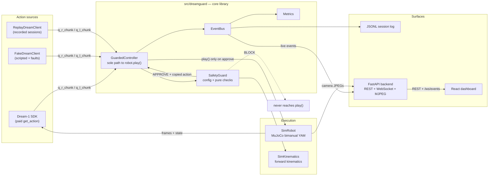

# DreamGuard architecture

DreamGuard is three layers around one rule: **every Dream-1 action chunk passes
through the safety engine before anything can execute it.**



ASCII version of the control loop:

```text
  observation (joints, grippers, cameras)
        ^                                    |
        |                                    v
   SimRobot / robot  <---- play() ----  GuardedController
        ^                                    |
        |                            APPROVE | BLOCK
        |                                    v
        +---------- Dream-1 --------->   SafetyGuard
                     action chunk        (all checks fail closed)
                                             |
                                             v
                                    SafetyEvent -> EventBus
                                      -> JSONL session file
                                      -> backend broadcaster -> dashboard
```

## Components

| Component | Location | Role |
|---|---|---|
| `SafetyGuard` | `src/dreamguard/guard.py` | Orchestrates validation, returns a `SafetyReport` |
| `checks` | `src/dreamguard/checks.py` | Pure check functions: schema, finiteness, limits, steps, velocity, gripper, workspace, separation |
| `SafetyConfig` / profiles | `src/dreamguard/config.py`, `profiles/` | Validated limits; `yam_sim.json` carries real YAM ranges |
| `SafetyReport` / `Finding` | `src/dreamguard/report.py` | Decision, structured findings, risk score, latency |
| `GuardedController` | `src/dreamguard/adapter.py` | Sole caller of `robot.play()`; derives current state from the observation; holds on block; halts after `max_consecutive_blocks` |
| `EventBus`, `JsonlSessionRecorder` | `src/dreamguard/events.py` | One JSON line per decision; subscriber failures never affect supervision |
| Metrics | `src/dreamguard/metrics.py` | Evaluated/approved/blocked counts, unsafe prevented, false rejections, latency percentiles |
| `SimRobot`, `SimKinematics`, scene | `src/dreamguard/sim/` | MuJoCo Menagerie i2rt YAM x2, table, cameras, FK to `grasp_site` |
| Sources | `src/dreamguard/sources/` | `dream1` (live SDK, budgeted, recorded), `fake` (scripted + 9 faults), `replay` |
| Backend | `backend/` | FastAPI: `/api/runs`, `/api/sessions`, `/api/safety`, `/api/stream/camera/{name}`, `/ws/events`; service layer in `src/resources/`; config-driven routers |
| Dashboard | `frontend/` | React + Vite + TS; TanStack Query for REST, typed WebSocket stream, Recharts |

## Data flow

1. A **source** produces an action chunk (`q_r_chunk`, `q_l_chunk`; rows of six
   joint targets + one gripper). The live source also sends the simulator's
   observation and camera frames to Dream-1 first.
2. `GuardedController.submit()` reads the measured joint state from the
   observation and calls `SafetyGuard.inspect()`.
3. The guard runs every configured check and returns a `SafetyReport`. Missing
   or malformed required data blocks the action (fail closed).
4. On **APPROVE** the controller plays a copy of the validated action. On
   **BLOCK** nothing is played and the robot holds its last pose; after
   `max_consecutive_blocks` (default 3) the controller halts until `reset()`.
5. Every outcome becomes a `SafetyEvent` on the bus: decision, findings, risk,
   latency, the action, the measured state, injected fault (if any), and
   executed/halted flags. Subscribers: the JSONL session recorder, metrics, and
   the backend's live broadcaster.
6. The **backend** owns a run's lifecycle (one run at a time, worker thread,
   real-time 20 Hz), serves recorded sessions and metrics over REST, broadcasts
   events over `/ws/events`, and streams cameras as MJPEG.
7. The **dashboard** renders cameras, run controls, fault injection, the
   decision feed with explanations, a risk chart, joint targets vs limits,
   session replay, and the active safety profile.

## Failure-handling invariants

- Blocked actions cannot reach `robot.play()` — proven by tests with a spy robot.
- A guard with an unusable configuration cannot be constructed.
- A required check that cannot run (missing state, missing FK) blocks the action.
- Session/event serialization never drops an event (NaN/Infinity are recorded as
  strings).
- Paid calls are counted before they are sent; refusals and failures count too.
  Tests never touch the network.
- One backend worker only: simulator and run state live in the process.
