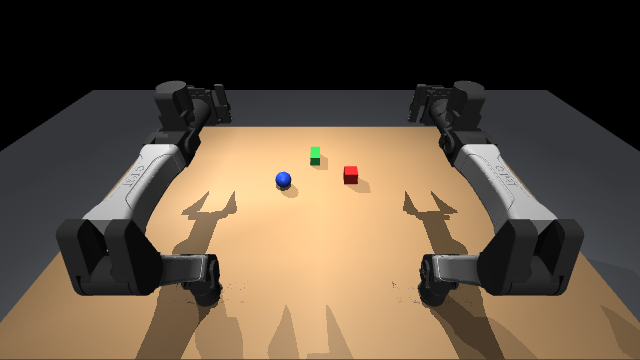
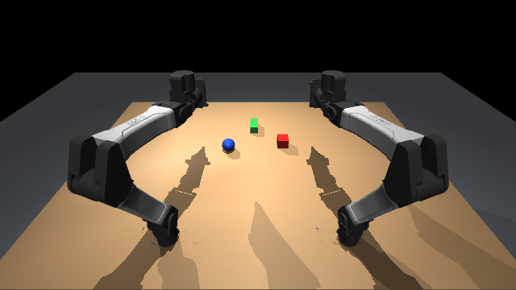
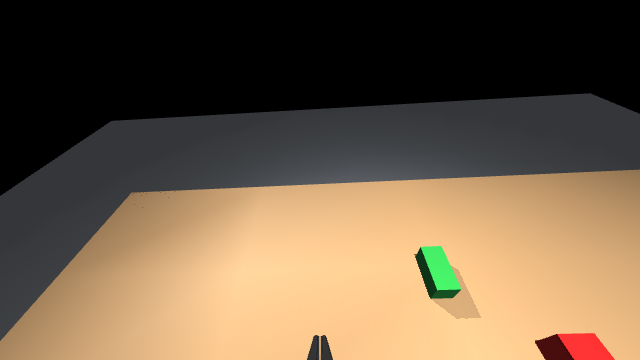
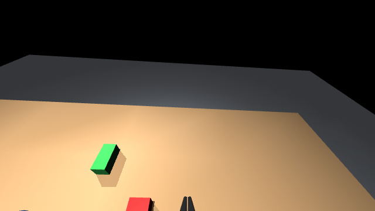

# DreamGuard demo guide

How to show DreamGuard working, from a five-minute offline run to the recorded
live Dream-1 session. Everything except the two marked steps is free and runs
without a network connection.

## Screenshots

| Overhead camera (home) | Overhead camera (mid-motion) |
|---|---|
|  |  |

| Left wrist | Right wrist |
|---|---|
|  |  |

The simulator scene: two i2rt YAM arms on a table with three objects, an
overhead camera and one camera per wrist — the same view Dream-1 sees.

## 1. Core guard demo (1 minute)

```powershell
python -m dreamguard.demo
```

A safe action is approved; a deliberately unsafe one is blocked with its
findings printed. No simulator needed.

## 2. Simulator demo (2 minutes)

```powershell
python -m dreamguard.sim.demo
```

Scripted motion runs in the MuJoCo simulator, then each of the nine injectable
faults is sent through the guard. Every fault is blocked by exactly the check
meant to catch it; the robot never executes a blocked row. Decisions are logged
to `logs/sessions/` and an overhead snapshot is written to `logs/`.

## 3. Dashboard walkthrough (5 minutes)

```powershell
cd backend; python main.py          # terminal 1 — http://127.0.0.1:8000
cd frontend; npm run dev            # terminal 2 — http://localhost:5173
```

Suggested flow on the **Live** page:

1. Point out the three camera feeds and the disconnected-safe state.
2. Start a **scripted** run — decisions stream into the feed, the risk chart
   draws, metrics count up.
3. Inject `joint_limit`, then `workspace` — each appears as a BLOCK with the
   fault tag; open a decision to show the "Why" panel (findings, executed=no).
4. Inject three faults in a row — the run halts; show the halt banner and the
   "Reviewed – resume run" button.
5. **Sessions** page: pick a recorded session, drag the slider through the
   decisions, start a replay run.
6. **Safety profile** page: the active YAM limits, read-only.

## 4. Recorded live session (the PRD scenario, real)

`fixtures/dream1/20261121T215356Z-ed761785.jsonl` holds the final 20-call live
run: **11 approved, 9 blocked**. Every block is Dream-1 commanding a right-arm
joint up to ~1.1° beyond the hard YAM limit — technically valid output that
DreamGuard caught before execution. The session copy under
`backend/logs/sessions/` can be stepped through on the Sessions page or
replayed through the guard for free.

## 5. Live Dream-1 (paid — only with an approved budget)

```powershell
.\.venv\Scripts\python scripts\dream1_attempt.py --preflight   # free, offline
$env:DREAMGUARD_ALLOW_PAID = "1"
python scripts\dream1_attempt.py --max-calls N --i-approve-paid-calls
```

Calls are counted before they are sent; every reply is recorded to
`fixtures/dream1/`. See `scripts/dream1_attempt.py --help`.

## Video storyboard (~90 seconds)

1. **Problem (10 s):** "Dream-1 generates robot actions. What stops an unsafe
   one from executing?"
2. **Architecture (15 s):** the diagram from `ARCHITECTURE.md` — every chunk
   passes through SafetyGuard; blocked chunks never reach `play()`.
3. **Simulator (15 s):** the screenshots above, then a scripted run with the
   cameras moving.
4. **Live catch (30 s):** the dashboard during a fault injection — decision
   feed, "Why" panel, robot holds its pose; then the recorded live session
   stats (11 approved / 9 blocked, real joint-limit violations).
5. **Close (20 s):** "AI can decide what a robot should do. DreamGuard checks
   whether it should be allowed to do it." — plus safety limitations on screen.
